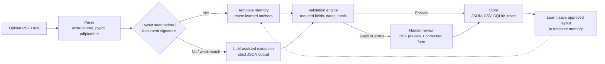

# AiOcr: AI Document Extraction That Gets Cheaper Every Time You Use It

**Turns invoices and other unstructured PDFs into clean, validated, structured data. Humans check only what needs checking, and every approved document makes the next one faster and cheaper.**

   

<!-- TODO: record a 20-second screen capture (upload invoice -> extracted fields -> validation -> approve), save it as docs/demo.gif, then remove these comment markers:

-->

---

## The problem

Companies receive invoices in hundreds of layouts. Typing them in by hand is slow and error-prone. Sending every document to an LLM works, but it costs money on every call, gives inconsistent results, and nobody verifies the output.

## The approach

**Use AI only when it's needed, keep a human in charge of correctness, and remember every approved layout so the same format never has to go to the LLM again.**

| | Typical "send it to an LLM" approach | AiOcr |
|---|---|---|
| Known layout | Pays for an LLM call every time | Reuses a learned template: **no LLM call** |
| New layout | LLM output trusted blindly | LLM extracts, rules validate, **a human approves** |
| Over time | Cost stays flat | **Cost falls** as template memory grows |
| Audit trail | Usually none | JSON, CSV, SQLite and trace logs for every run |

<!-- TODO: fill in real numbers, then remove these comment markers to show this section.
## Results

| Metric | Result |
|-->

---|---|
| Field-level accuracy (required fields) | `[X]%` on `[N]` test invoices |
| Time per document | `[X] min` manual → `[Y] sec` with AiOcr |
| LLM calls saved on repeated layouts | `[X]%` after first approval |

---

## How it works



1. **Parse:** open-source parsers turn PDFs and text into clean content.
2. **Route:** a document signature checks whether this layout has been seen before.
3. **Extract:** known layouts use template memory (free and consistent). New ones go to the LLM with a strict JSON-only prompt.
4. **Validate:** rule checks catch missing fields, bad dates and totals that don't add up.
5. **Review:** a human sees the original PDF next to the extracted fields and fixes anything wrong.
6. **Learn:** approved results become templates, so the next document with that layout skips the LLM.

---

## Key design decisions

These are the architecture choices behind the system.

**1. A parsing pipeline built on open-source parsers.** Parsing is separate from extraction. Each document is converted to clean text and structure first, using `unstructured`, `pypdf` and `pdfplumber`, so the extraction logic doesn't depend on the input format. Adding a new file type means writing a parser, not rewriting the pipeline.

**2. Human-in-the-loop as part of the core design, not an afterthought.** An LLM can be confidently wrong, so nothing is trusted just because a model produced it. Validation rules decide when a human is needed, and the review screen shows the source PDF beside the extracted values. **Unreviewed LLM output never updates template memory**, which keeps errors from compounding.

**3. Template memory to reduce cost.** The system remembers each approved layout through document signatures (structure and keywords) and field anchors (which labels map to which fields). Repeated vendors and formats are handled locally with no API cost, and the results are more consistent than re-asking an LLM each time. The system improves over time **without fine-tuning any model**.

**4. Using AI only where it adds value.** The LLM is a reasoning layer for unfamiliar layouts, not the whole system. It is provider-agnostic: OpenAI, Groq, OpenRouter, or fully local with Ollama. It is called only when templates and rules can't handle a document, and it uses a strict JSON-only extraction request so its output plugs straight into validation.

**5. Environment-isolated learning.** Template memory learned in `dev` or `test` never overwrites production memory automatically. It is promoted on purpose through a GitHub Actions workflow, the same way code is.

---

## My role

*Graduate capstone project at UT Dallas, built as a team.*

**Tanvi Mehta:** designed the overall system architecture and led the technical design of:
- the **parsing approach** (format-independent parsing layer)
- the **human-in-the-loop review workflow** (validation-driven review, approval gates for learning)
- the **template memory** concept that reduces LLM cost on repeated layouts
- the **AI integration strategy** (when to call the LLM, strict JSON output, provider-agnostic design)

<!-- TODO: add teammates' names / GitHub handles here, e.g. "Team: @cjm010, ..." -->

---

## Quick start

```bash
git clone https://github.com/TanviMehta2495/AiOcr.git
cd AiOcr
python -m venv .venv && source .venv/bin/activate   # Windows: .venv\Scripts\activate
pip install -r requirements.txt
cp .env.example .env                                 # Windows: copy .env.example .env
python -m streamlit run app.py
```

To use `llm-assisted` mode, either paste your API key and pick a model in the Streamlit sidebar, or set `LLM_PROVIDER`, `OPENAI_API_KEY` and `OPENAI_MODEL` in `.env`.

**No API budget?** Try **Groq** (free developer tier), **OpenRouter** (free model variants) or **Ollama** (fully local, no per-call cost).

A Colab version is also included: `AI_Document_Extraction_Colab.ipynb`.

---

## Extraction modes

| Mode | What it does | Best for |
|---|---|---|
| `llm-assisted` | Calls the LLM for unfamiliar layouts, then validation and review | **New** invoice formats (recommended) |
| `adaptive-local` | Learned templates first, then rule-based and heuristic fallback | **Repeated** formats, lowest cost |
| `template-only` | Uses only previously learned templates | Known vendors, fully deterministic |
| `rule-based` | Regex and label-based extraction, no memory | Baseline and comparison |

API keys entered in the UI stay in the active Streamlit session only. They are never written to repo files, outputs or the template store.

---

## Tech stack

**Python 3.11** · **Streamlit** · `unstructured` / `pypdf` / `pdfplumber` · OpenAI-compatible LLM APIs (OpenAI, Groq, OpenRouter, Ollama) · **SQLite** · **GitHub Actions** (CI, release smoke check, learning promotion)

---

<details>
<summary><b>Technical details: architecture layers, learning, configuration, CI/CD</b></summary>

### Architecture layers

1. **Presentation:** Streamlit UI for upload, extracted fields, validation results, PDF preview, parsed text and the correction form.
2. **Ingestion and parsing:** saves uploads locally and parses them with `unstructured`, `pypdf` and `pdfplumber`.
3. **Extraction:** builds a document signature, checks template memory, reuses learned anchors on a match, falls back to rules and heuristics, and calls the optional LLM layer for new or weakly matched formats.
4. **Validation and review:** validates required fields, dates, totals and output quality, lets users correct values, then re-runs validation.
5. **Persistence and learning:** saves JSON, CSV, SQLite and trace output, and stores templates from high-quality approved runs.

### How the system learns (no model training)

- **Document signature learning:** remembers top-line structure and key keywords.
- **Template anchor learning:** remembers which labels and line patterns map to which fields.
- **Human-reviewed feedback:** approved corrections improve future matching.

The app reuses learned templates as soon as a layout looks similar, but falls back to the LLM if the template result is too incomplete. Users can explicitly approve either the extracted result or their correction for future matching.

### Project layout

| Path | Purpose |
|---|---|
| `app.py` | Streamlit UI and review workflow |
| `src/doc_ai/pipeline.py` | End-to-end orchestration |
| `src/doc_ai/parsers.py` | PDF and text parsing |
| `src/doc_ai/extractors.py` | Adaptive, template, rule-based and LLM extraction |
| `src/doc_ai/template_memory.py` | Learned signatures and anchors |
| `src/doc_ai/validators.py` | Data-quality rules |
| `src/doc_ai/storage.py` | JSON, CSV, SQLite and trace persistence |
| `src/doc_ai/schemas.py` | Shared data structures |
| `src/doc_ai/config.py` | Settings and paths |

### Supported inputs

PDF (best with a text layer; scanned PDFs may need OCR), `.txt`, `.md`, `.json`.

### Environment variables

| Variable | Purpose |
|---|---|
| `APP_ENV` | Environment name: `dev`, `test` or `prod` |
| `APP_DATA_ROOT` | Base folder for isolated per-environment data |
| `APP_DATA_DIR` | Overrides the local data directory |
| `ENABLE_TEMPLATE_LEARNING` | Learn from successful reviewed or validated runs |
| `MIN_LEARNING_PASS_RATIO` | Minimum validation pass ratio before saving a template |
| `LLM_PROVIDER` | `openai`, `groq`, `openrouter` or `ollama` |
| `LLM_BASE_URL` | Override the endpoint for a compatible hosted or local API |
| `OPENAI_API_KEY` | Enables the LLM path without entering the key in the UI |
| `OPENAI_MODEL` | Default model for `llm-assisted` mode |

### CI/CD and environments

Three environments: `dev` → `test` → `main` (production).

- `.github/workflows/ci.yml`: install, import smoke checks and tests on every PR and push
- `.github/workflows/release.yml`: protected production smoke check on `main`
- `.github/workflows/promote-learning.yml`: manually promotes approved learning artifacts to a higher environment

See [docs/BRANCHING_AND_LEARNING_STRATEGY.md](docs/BRANCHING_AND_LEARNING_STRATEGY.md).

</details>

---

## Roadmap

- OCR for scanned PDFs without a text layer
- Document types beyond invoices (reports, agreements)
- Confidence scores per field to sharpen review routing
- Richer data-quality profiling

*Status: working capstone prototype, invoice-focused as the first milestone.*
